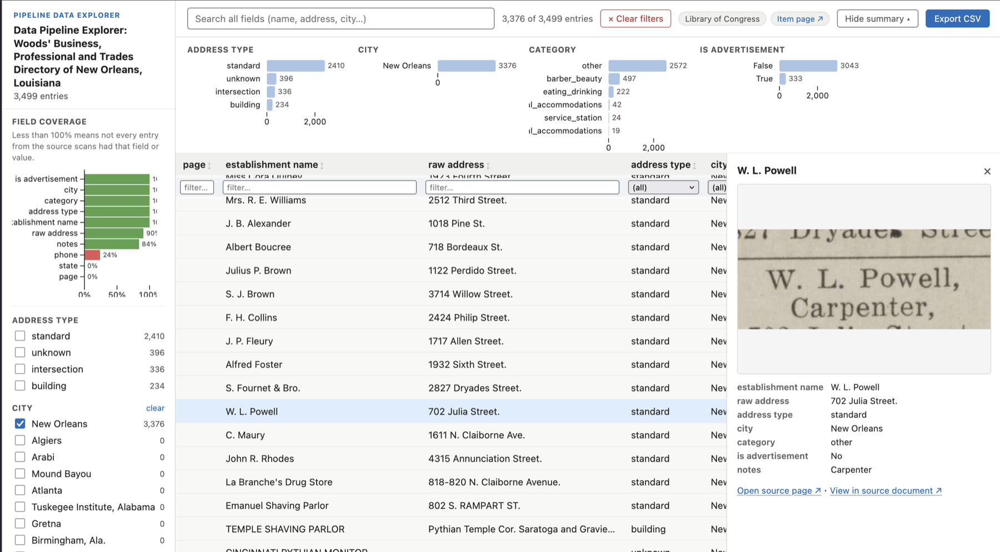
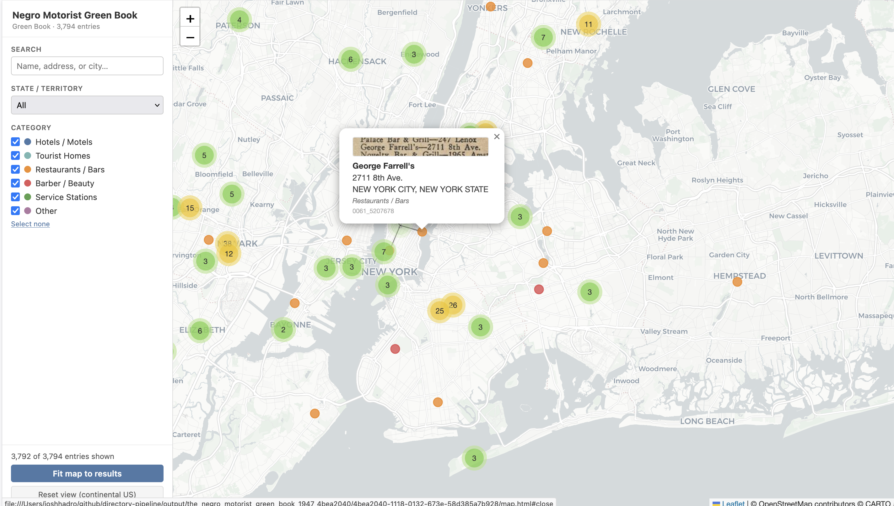
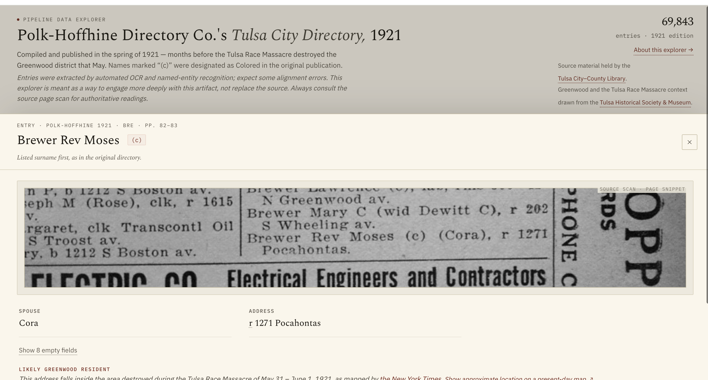
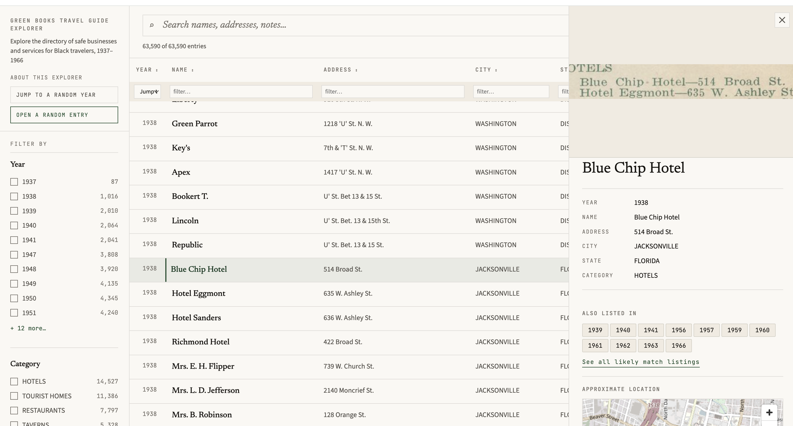
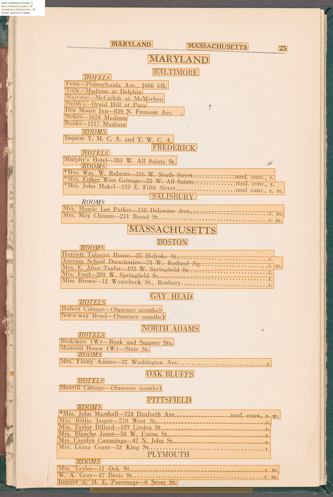

# directory-pipeline

Turn a public digital archive URL into a structured, browsable CSV — no manual transcription, no custom code per collection type.

Give it a URL from the [Library of Congress](https://www.loc.gov/collections/), [Internet Archive](https://archive.org/), or any institution that publishes a public IIIF manifest (CONTENTdm repositories included). It downloads the scans, OCRs them, and extracts entries into a structured CSV. Every row links back to its page in the original scan and, with the enrichment steps, to the exact line.

Built for digitized historical directories — city directories, gazetteers, trade directories — but works on just about any historical document with regular entry-like structure.



*The auto-generated data explorer. Categorical facets generated from the data, full-text search, IIIF page thumbnails, and a "View in source document" deep link for every row.*

---

## Quick start

Requires Python 3.11+ and [uv](https://docs.astral.sh/uv/).

```bash
uv sync                      # creates .venv/ and installs the `pipeline` command
source .venv/bin/activate    # puts `pipeline` on your PATH (or prefix each command with `uv run`)

# One-time calibration for a new collection type — generates OCR and NER
# prompts that will work for any item with the same entry structure
pipeline ingest    https://archive.org/details/ldpd_11290437_000/
pipeline calibrate https://archive.org/details/ldpd_11290437_000/

# Automated run — produces the entries CSV + browsable HTML explorer
pipeline run       https://archive.org/details/ldpd_11290437_000/

# Or the human-in-the-loop version of the same run: adds page scoping,
# #xywh= bounding boxes, and interactive alignment review (needs GPU or Apple Silicon)
pipeline guided    https://archive.org/details/ldpd_11290437_000/
```

**Calibrate once, run many.** `pipeline calibrate` is a one-time step per collection type: it opens a browser UI where you pick 4–10 representative pages, then has Gemini analyze them and write tailored OCR and extraction prompts. For any additional volume in the same series, point to the first volume's NER prompt and skip calibration entirely:

```bash
pipeline run https://archive.org/details/ldpd_11290437_001/ \
  --ner-prompt output/ldpd_11290437_000/ner_prompt.md
```

Requires `GEMINI_API_KEY`. Can run on the [free tier](#costs) — no billing required for collections up to ~150 pages. Flex inference (~50% cheaper API calls, 1–15 min latency per request, best-effort availability) is on by default; pass `--no-flex` for time-sensitive runs.

---

## What you get

A CSV where every row is one extracted entry. Field names are driven entirely by your NER prompt — no code changes necessary for a new document or volume of the same type. An example entry from a travel guide:

| name | address | city | state | category | canvas_fragment |
|---|---|---|---|---|---|
| Mrs. Simmons Tourist Home | 418 Johnson St | Augusta | GA | Tourist Home | `https://...#xywh=142,890,1240,68` |

The `canvas_fragment` column is a IIIF URI pointing back to the source scan. With the [precision upgrade](#precision-upgrade), it includes a `#xywh=` bounding box pinpointing the exact line. The data explorer and map use this to link directly to the highlighted entry in the original document.

Alongside the extracted data CSV, `pipeline run` also generates a self-contained HTML data explorer (shown above). With geocoding enabled on materials with address fields, you also get:



*Markers clustered and color-coded by category. Popups include a IIIF thumbnail fetched directly from the source institution's image server.*

---

## Examples

Two published collections built with this pipeline:

- **[Tulsa city directories — 1921](https://hadro.github.io/tulsa-city-directories/1921#about)** — a Polk-style city directory.
- **[The Negro Motorist Green Book and other Black travel guides explorer](https://hadro.github.io/green-books/all-volumes)** — the full run of the Green Book plus seven other travel guides for Black travelers: about 113,800 listings across 50 volumes, 1930–1966.

<p>
  <a href="https://hadro.github.io/tulsa-city-directories/1921#about"></a>
  <a href="https://hadro.github.io/green-books/all-volumes"></a>
</p>

*Entry detail views from the published explorers. Left: each Tulsa entry renders the exact line from the source scan via its `canvas_fragment` URI. Right: a Green Book establishment with its listing history across volumes.*

> Both explorers received additional front-end design work beyond what the pipeline generates. The pipeline produces the entry CSVs, IIIF manifests, and a baseline HTML explorer; these published sites build on that output.

---

## Installation

```bash
uv sync                  # core: Gemini OCR + entry extraction
uv sync --extra gpu      # add Surya OCR (GPU or Apple Silicon recommended)
uv sync --extra geo      # add geocoding + map generation
uv sync --all-extras     # everything
```

`uv sync` creates and manages the project's virtual environment in `.venv/` and installs the `pipeline` command into it — there is no environment to create yourself, and no conda. Either activate it once (`source .venv/bin/activate`) or prefix each command with `uv run`. Everything below is written in the bare form, and the same applies to the underlying `python main.py …` interface.

Set your API keys (or copy `.env.template` to `.env`):

```bash
export GEMINI_API_KEY=your_key_here
export GOOGLE_MAPS_API_KEY=your_key_here   # optional; enables address-level geocoding
```

<details>
<summary><strong>Already have Anaconda?</strong></summary>

This project is uv-native — there is no conda environment to install. Let uv manage its own interpreter and leave conda out of the way:

```bash
uv python install 3.12
uv sync --extra gpu
```

Two things bite conda users in particular:

**An Intel Python on an Apple Silicon Mac.** macOS runs x86_64 interpreters under Rosetta silently, and Anaconda's Intel installer is easy to grab by accident. PyTorch has shipped no macOS x86_64 wheel since 2.2.2, so `uv sync --extra gpu` fails to resolve Surya — and a torch installed from conda-forge (which still builds `osx-64` from source) will run emulated and CPU-only on a machine with a perfectly good GPU. `main.py` warns when it detects this. Check yours with:

```bash
python -c "import platform; print(platform.machine())"   # want: arm64
```

**Notebooks running on the wrong kernel.** `uv sync` installs into `.venv/`, which is not the conda kernel Jupyter starts with — so imports fail even though the packages are installed. Register the project venv as a kernel and select it from the Kernel menu:

```bash
uv run python -m ipykernel install --user --name directory-pipeline
```

</details>

---

## Commands

Run `pipeline --help` for all subcommands, and `pipeline <subcommand> --help` for each one's options:

```bash
pipeline run    <URL>          # automated: download → OCR → extract → explore
pipeline guided <URL>          # human-in-loop: page selection + alignment review
pipeline ingest <URL>          # download only
pipeline calibrate <URL|DIR>   # select sample pages + generate prompts (once per collection type)
pipeline ocr    <DIR>          # Surya OCR + Gemini OCR + align bboxes
pipeline review  <DIR>         # interactive alignment review (browser UI)
pipeline extract <DIR>         # NER extraction + explorer
pipeline geo     <DIR>         # geocode entries + build map (needs address fields)
pipeline postprocess <DIR>     # fix + combine volumes + rebuild explorer
```

Each subcommand wraps the underlying `python main.py <URL> [flags]` stage interface — see [docs/pipeline-stages.md](docs/pipeline-stages.md) for the flag-level reference and every artifact each stage produces.

Beyond the subcommands:

| Goal | Command |
|---|---|
| Improve accuracy on complex layout-dependent materials | `pipeline extract output/<vol>/ --mode multimodal` [→ details](#multimodal-extraction) |
| Review entries that could not be placed on a line | `python tools/collate_review_queue.py output/<vol>/` |
| See what a run actually cost | `python tools/report_cost.py output/<vol>/` |
| Export ALTO XML (Solr, IIIF Content Search) | `python main.py output/<vol>/ --export-alto` |
| Export W3C/IIIF annotations | `python -m pipeline.iiif.export_annotations output/<vol>/` |
| Extract one section of a huge volume without downloading it all | `python tools/slice_manifest.py <MANIFEST> --from-id … --to-id … --slug <slug>` [→ details](docs/usage-examples.md#extracting-only-part-of-a-large-volume) |
| Use pipeline pieces from a notebook or script | `from pipeline.api import iter_canvases, …` [→ details](docs/usage-examples.md#9-using-pieces-as-a-library) |

### Precision upgrade

The core `pipeline run` path gives you a canvas URI per row. Adding Surya OCR and alignment upgrades each entry's `canvas_fragment` to a `#xywh=` bounding box on its exact line, usable by any IIIF viewer. An entry the pipeline cannot place confidently keeps its page link and goes on the review list rather than getting a guessed box.

```bash
pipeline ocr    output/<vol>/    # Surya bboxes + alignment (requires GPU or Apple Silicon)
pipeline review output/<vol>/    # optional: fix unmatched lines interactively
```



### Multimodal extraction

By default extraction sends the OCR text to Gemini. `--mode multimodal` also sends the page image, so the model can see section headings, column boundaries and layout cues that OCR text loses. It helps most where headings fall mid-page or reading order is ambiguous — on Green Book volumes it eliminated mid-page geographic attribution errors — and adds about $0.00006 per page ([costs](docs/costs.md)).

```bash
pipeline extract output/<vol>/ --mode multimodal
```

---

## Costs

A single ~80-page volume costs roughly **$0.30–$0.40 in Gemini API charges with `--flex`**, about twice that at standard rates, and fits within the free tier's daily quota (the 15 RPM limit stretches the API stages to 15–20 minutes). `python tools/report_cost.py output/<vol>/` reports what a run actually spent, from the token usage each stage records. See [docs/costs.md](docs/costs.md) for the full breakdown, including platform costs for Surya OCR (Mac, Colab, and GPU).

---

## Docs

- [Pipeline stage reference](docs/pipeline-stages.md) — every flag, script, and output file, including the [artifact naming contract](docs/pipeline-stages.md#artifacts-and-naming-conventions) (what each stage writes/reads, and how models are auto-detected)
- [Usage examples](docs/usage-examples.md) — full examples by source (LoC, IA, IIIF manifest)
- [Costs](docs/costs.md) — API and platform cost breakdown
- [Key design decisions](docs/key-design-decisions.md) — architecture and technical notes
- [Prior work](docs/prior-work.md) — related research and citations
- [Documentation index](docs/README.md) — every doc, including the plans and the evidence sets behind the pipeline's thresholds and decisions

## Key design decisions

- **Gemini for accuracy, Surya for coordinates.** Gemini transcribes historical print far more accurately than conventional OCR; Surya provides line-level bounding boxes that anchor coordinates.
- **Anchored, column-aware alignment.** City/state headings that appear verbatim in both sources are committed as fixed anchors before the Needleman-Wunsch pass, and multi-column pages are aligned one column at a time where that is safe, so a single mistake cannot drift through the rest of the page.
- **No guessed boxes.** An entry gets a bounding box only when its name or address matches an aligned line confidently. Otherwise it keeps its page link and is listed for review: a confidently wrong box is worse than none.
- **Schema-agnostic NER.** `extract_entries.py` hard-codes nothing. The NER prompt defines all field names; CSV columns are inferred dynamically — no code changes for a new collection type.
- **IIIF-native output.** Every row carries a `canvas_fragment` URI, and placed entries a `#xywh=` box in natural image pixel coordinates, directly consumable by IIIF viewers and annotation tools.
- **Any IIIF source.** `--iiif-csv` and `--download` accept any public IIIF Presentation v2 or v3 manifest URL, not just LoC and IA, and IIIF Collection manifests are enumerated one child manifest per CSV row. CONTENTdm repositories work via `sources/build_contentdm_manifest.py`.

See [docs/key-design-decisions.md](docs/key-design-decisions.md) for full technical notes.

---

## Prior work and inspirations

- **Greif et al. (2025)** — foundational benchmark showing multimodal LLMs beat Tesseract + Transkribus on historical city directories (0.84% CER with Gemini 2.0 Flash). Directly motivates the two-stage OCR + NER architecture. ([arXiv:2504.00414](https://arxiv.org/abs/2504.00414))
- **Bell et al. — *directoreadr* (2020)** — closest prior work; end-to-end pipeline for Polk city directories using classical CV + Tesseract. Documents the brittle year-specific heuristics this pipeline replaces. ([PLOS ONE](https://doi.org/10.1371/journal.pone.0220219))
- **Wolf et al. (2020)** — machine-readable NYC directory entries 1850–1890 from NYPL digitizations. Direct precedent for applying this pipeline to city directories. ([NYU Faculty Digital Archive](https://archive.nyu.edu/handle/2451/61521))

See [docs/prior-work.md](docs/prior-work.md) for these and other annotated citations, including the Green Books digitization the category taxonomy comes from.
